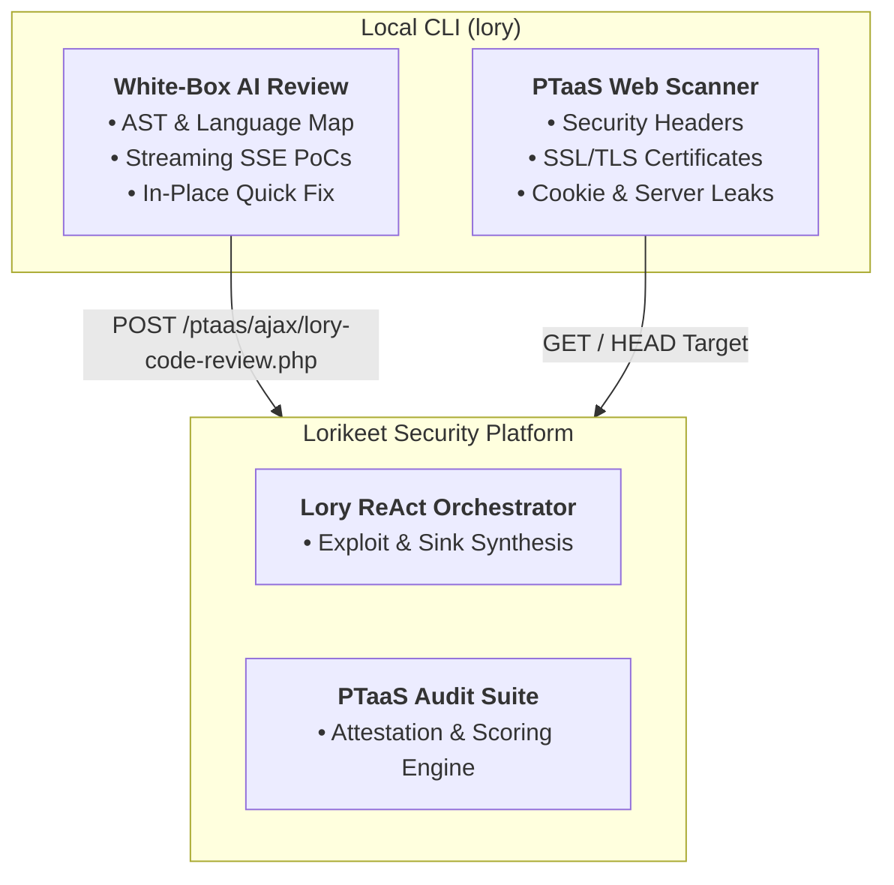
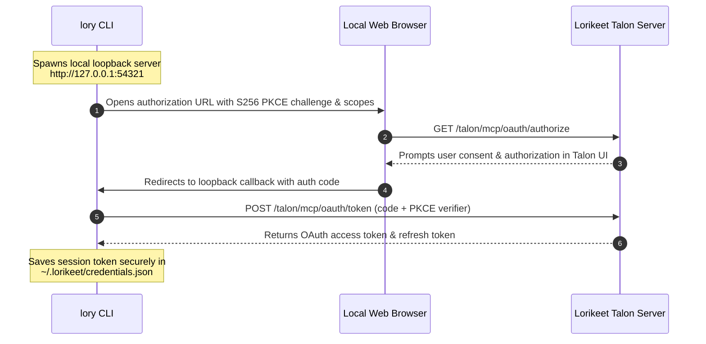

# Lory CLI (`lory`)

<p align="center">
  <pre>
 _        ___   ____  __   __
| |      / _ \ |  _ \ \ \ / /   LORIKEET SECURITY
| |     | | | || |_) | \ V /    AI Security Analyst & PTaaS Platform
| |___  | |_| ||  _ <   | |     Lory Review & Web Security Scanner
|_____|  \___/ |_| \_\  |_|     v1.1.0
  </pre>
  <p align="center">
    <strong>Autonomous, hybrid-intelligence security testing and AI code review directly from your terminal.</strong>
  </p>
  <p align="center">
    <a href="https://lorikeetsecurity.com"></a>
    <a href="LICENSE"></a>
    <a href="https://modelcontextprotocol.io"></a>
    <a href="https://github.com/oasis-tcs/sarif-spec"></a>
  </p>
</p>

---

`lory` is the official local command-line interface for [Lorikeet Security](https://lorikeetsecurity.com). It bridges local source code security review with active PTaaS web application verification, providing developers, AppSec engineers, and CI/CD pipelines with real-time vulnerability detection and instant auto-remediation.

---

## Table of Contents

- [1. Overview & Architecture](#1-overview--architecture)
- [2. Installation & Quickstart](#2-installation--quickstart)
- [3. Core Commands](#3-core-commands)
  - [Talon OAuth SSO Login (`login`)](#talon-oauth-sso-login-login)
  - [Identity & Session Status (`whoami`)](#identity--session-status-whoami)
  - [Session Logout (`logout`)](#session-logout-logout)
  - [Lory AI Code Review (`review`)](#lory-ai-code-review-review)
  - [Auto-Remediation Quick Fix (`fix`)](#auto-remediation-quick-fix-fix)
  - [Web Security Scanner (`scan`)](#web-security-scanner-scan)
  - [Git Diff & Pre-Commit (`diff`)](#git-diff--pre-commit-diff)
  - [Access Token Management (`token`)](#access-token-management-token)
  - [Website Trust Badge (`badge`)](#website-trust-badge-badge)
  - [Model Context Protocol Server (`mcp serve`)](#model-context-protocol-server-mcp-serve)
- [4. Inline Suppression Directives](#4-inline-suppression-directives)
- [5. CI/CD Integration](#5-cicd-integration)
- [6. Privacy & Telemetry](#6-privacy--telemetry)
- [7. Building from Source](#7-building-from-source)

---

## 1. Overview & Architecture

`lory` operates across two primary security dimensions:



1. **White-Box Code Analysis**: Evaluates source code files across 25+ programming languages using Lorikeet's real-time AI engine. Findings stream back in real-time with exact line numbers, CWE mappings, confidence scores, and code patches.
2. **Dual-Mode Engine**: Operates against the Lorikeet Platform API when connected, with automatic fallback to an offline SAST engine when working in air-gapped or sandboxed environments.
3. **PTaaS Target Auditing**: Executes non-intrusive security header, SSL/TLS, and server disclosure scans against web targets matching the Lorikeet PTaaS platform.

---

## 2. Installation & Quickstart

### One-Line Install (Linux & macOS)

Install the standalone binary directly to your system:

```bash
curl -fsSL https://lorikeetsecurity.com/install.sh | bash
```

Or install with Go:

```bash
go install github.com/Lorikeet-Security/lory-cli@latest
```

### Standalone Binary (Zero Dependencies)

```bash
# Clone repository
git clone https://github.com/Lorikeet-Security/lory-cli.git
cd lory-cli

# Compile standalone binary
make build

# Optional: Install to system PATH (/usr/local/bin)
sudo make install
```

### Verification

```bash
lory version
# Output: lory version 1.1.0 (Lorikeet Security AI Reviewer)
```

---

## 3. Core Commands

### Talon OAuth SSO Login (`login`)

`lory` natively integrates with the official **Lorikeet Security Talon Single Sign-On (SSO)** OAuth 2.0 authorization provider with RFC 7636 PKCE (S256):

```bash
# Launch interactive browser authentication via Talon OAuth
lory login

# Authenticate with custom port (defaults to 54321 with dynamic fallback)
lory login --port 54321

# Authenticate non-interactively via API key (ideal for CI/CD)
lory login --api-key "lkmcp_xxxxxxxxxxxxxxxx"
```

#### How Talon OAuth Authorization Works



- **Authorization Endpoint**: `https://lorikeetsecurity.com/talon/mcp/oauth/authorize`
- **Token Endpoint**: `https://lorikeetsecurity.com/talon/mcp/oauth/token`
- **Scopes Requested**:
  - `findings:read`: Access project vulnerability findings and assets
  - `kb:read`: Query the vulnerability remediation knowledge base
  - `compliance:read`: Access compliance frameworks and control mappings
- **PKCE Verification**: Uses cryptographically secure random `code_verifier` hashed with `SHA-256` (`code_challenge_method=S256`), preventing authorization code interception attacks.

### Identity & Session Status (`whoami`)

Inspect the currently authenticated Talon identity, active scopes, and token expiration:

```bash
lory whoami
```

Sample output:
```text
  LORIKEET SECURITY TALON SESSION
  Status:       Authenticated
  User:         alice@company.com
  Workspace:    Lorikeet Enterprise (org_ent_enterprise)
  Auth Method:  oauth_pkce
  Scopes:       findings:read, kb:read, compliance:read
  Expires In:   29 days (2026-11-24 13:45:00 UTC)
```

### Session Logout (`logout`)

Securely terminates the active session, clears cached tokens, and removes local credentials from `~/.lorikeet/credentials.json`:

```bash
lory logout
```

---

### Lory AI Code Review (`review`)

Recursively scans code repositories or individual files:

```bash
# Review entire workspace
lory review .

# Review a specific file
lory review src/api/users.py

# Review without streaming (batch output)
lory review --stream=false src/

# Filter by minimum severity (critical, high, medium, low, info)
lory review --min-severity=high .
```

Sample output:
```text
#1  [CRITICAL] SQL Injection (Concatenated query) (CWE-89)
    Location:   src/db/queries.ts:24 (confidence: high)
    Detail:     Direct user input is concatenated into dynamic SQL statement without parameterized query binding.
    Quick Fix:  db.query("SELECT * FROM users WHERE id = $1", [req.query.id])
    Note:       Bind dynamic user input via SQL query parameters.
```

### Auto-Remediation Quick Fix (`fix`)

Applies Lory's verified quick fixes directly to files in place:

```bash
# Review and automatically apply suggested fixes
lory fix src/db/queries.ts

# Apply fixes across all files in workspace
lory fix .
```

### Web Security Scanner (`scan`)

The `scan` command is polymorphic: provide a URL to audit live endpoints or a path to review source code:

```bash
# Audit live web application
lory scan https://example.com

# Review local directory
lory scan ./src

# Output scan results as JSON
lory scan --format=json https://example.com
```

Checks performed:
- **Security Headers**: HSTS, Content-Security-Policy (CSP), X-Frame-Options, X-Content-Type-Options, Referrer-Policy, Permissions-Policy.
- **SSL / TLS**: HTTPS enforcement, HTTP-to-HTTPS redirects, certificate validity, expiration countdown, and issuer verification.
- **Cookie Flags**: `Secure`, `HttpOnly`, and `SameSite` flags.
- **Information Leakage**: `Server` header version disclosures, `X-Powered-By`, and detected tech stacks.
- **Common Files**: `robots.txt`, `.well-known/security.txt`, `sitemap.xml`.
- **Posture Score**: Computes an audit-ready score from 0 to 100.

### Git Diff & Pre-Commit (`diff`)

Reviews only files modified in your git working tree:

```bash
# Review unstaged modified files
lory diff

# Review staged files before committing
lory diff --cached

# Review changes between branches
lory diff main...feature-branch
```

### Access Token Management (`token`)

Lory supports an anonymous tier (30 requests/min, keyed to egress IP). Authenticating with your Lorikeet access token raises the ceiling to 120 req/min:

```bash
# Set access token (retrieved from Lorikeet Portal)
lory token set lkmcp_xxxxxxxxxxxxxxxx

# Inspect current token state
lory token show

# Clear saved token and revert to anonymous tier
lory token clear
```

Alternatively, set the environment variable in your shell or CI environment:
```bash
export LORIKEET_TOKEN="lkmcp_xxxxxxxxxxxxxxxx"
```

### Website Trust Badge (`badge`)

Display a verified **"Secured by Lorikeet Security"** cryptographic trust seal in your website footer or documentation after completing an assessment:

```bash
# Generate footer HTML and Markdown embed snippets
lory badge https://yourcompany.com

# Export standalone SVG for dark or light themes
lory badge --style pill --theme dark --format svg --out lorikeet-badge.svg
lory badge --style shield --format svg --out lorikeet-shield.svg

# Customize score or attestation status
lory badge --target yourcompany.com --score 98 --status VERIFIED
```

#### Embed in Website Footer:
```html
<a href="https://lorikeetsecurity.com/verify?host=yourcompany.com" target="_blank" rel="noopener noreferrer">
  
</a>
```

Pre-rendered badges and a live interactive preview are available in `assets/badges/` (`demo.html`).

### Model Context Protocol Server (`mcp serve`)

`lory` implements the Model Context Protocol (MCP) stdio specification for native integration with **Claude Code**, **Cursor**, and **Windsurf**:

#### Claude Code Configuration (`~/.claude.json`)

```json
{
  "mcpServers": {
    "lory": {
      "command": "lory",
      "args": ["mcp", "serve"]
    }
  }
}
```

Exposed Tools:
- `lory_review_file`: Analyzes workspace code files for security vulnerabilities.
- `lory_scan_target`: Performs passive PTaaS web security audits on target URLs.
- `lory_explain_finding`: Returns comprehensive remediation guidance and CWE details.

---

## 4. Inline Suppression Directives

Lory supports code comments to safely silence intentional patterns:

```javascript
// lory-ignore  id parameter is sanitized by upstream middleware
db.query(`SELECT * FROM users WHERE id = '${id}'`);
```

- `lory-ignore`: Silences findings on the current line or subsequent line.
- `lory-ignore-next-line`: Silences findings strictly on the subsequent line.
- `lory-ignore-file`: Place anywhere within the first 20 lines of a file to skip scanning the entire file.

---

## 5. CI/CD Integration

### GitHub Actions Workflow

Add `.github/workflows/security.yml` to your repository:

```yaml
name: Lory Security Review

on:
  pull_request:
    branches: [main]
  push:
    branches: [main]

jobs:
  review:
    name: Code & Web Security Audit
    runs-on: ubuntu-latest
    steps:
      - uses: actions/checkout@v4

      - name: Install Lory CLI
        run: |
          curl -fsSL https://lorikeetsecurity.com/install.sh | bash

      - name: Review Git Changes
        env:
          LORIKEET_TOKEN: ${{ secrets.LORIKEET_TOKEN }}
        run: |
          lory diff
```

---

## 6. Privacy & Telemetry

When reviewing code:
- Only the specific source file or selection undergoing review is transmitted.
- Only the **base filename** (e.g. `users.ts`) is sent; full local filesystem paths and repository names are stripped.
- Requests carry no identifying system metrics beyond your optional access token.
- Code is processed ephemerally in-memory and is not retained or used for model training.

---

## 7. Building from Source

Requirements: Go 1.22+

```bash
# Build binary
make build

# Run automated tests
make test

# Clean artifacts
make clean
```

---

## License

Distributed under the Apache 2.0 License. See [LICENSE](LICENSE) for more information.

Developed by [Lorikeet Security Inc.](https://lorikeetsecurity.com)
