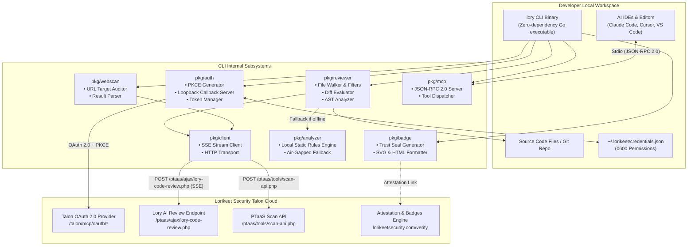
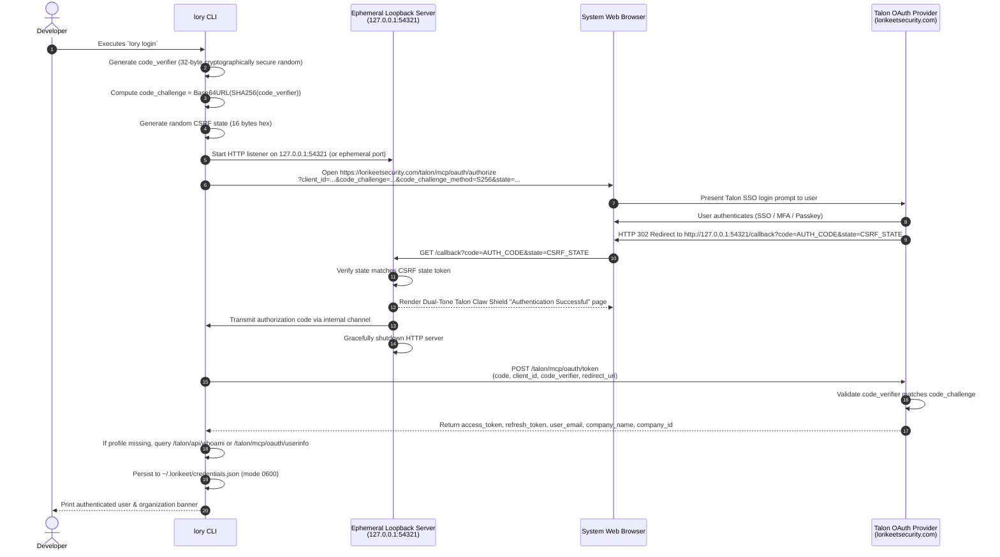
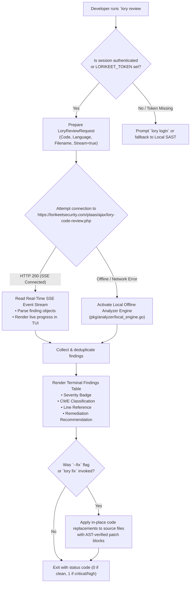

# Lorikeet CLI Architecture

`lory` is built as a zero-dependency, standalone Go binary designed for high performance, portability across developer workstations and CI/CD pipelines, and seamless interaction with the **Lorikeet Security Talon Platform**.

---

## 1. High-Level System Architecture

The following diagram illustrates the interaction between `lory`, the developer workspace, and the Lorikeet Security cloud platform:



---

## 2. Talon OAuth 2.0 PKCE Loopback Flow

To securely authenticate developer terminals without exposing API secrets or requiring manual token copying, `lory` implements an **RFC 7636 PKCE (Proof Key for Code Exchange)** loopback authorization flow using SHA-256 (`S256`):



---

## 3. Dual-Mode Review Execution Pipeline

`lory review` and `lory fix` are engineered with continuous operational availability in mind:



---

## 4. Component Layout

The codebase is organized into modular packages:

```text
lory-cli/
├── apps/
│   └── cli/
│       ├── cmd/               # CLI Command implementations (review, scan, badge, etc.)
│       └── main.go            # Entrypoint and flag parsing
├── pkg/
│   ├── analyzer/              # Offline AST static analysis and fallback engine
│   ├── auth/                  # PKCE OAuth 2.0 loopback server and token storage
│   ├── badge/                 # Trust badge generation and SVG/HTML template rendering
│   ├── client/                # Platform HTTP client and SSE event-stream parser
│   ├── export/                # SARIF 2.1.0 and compliance export formats
│   ├── mcp/                   # Model Context Protocol stdio server
│   ├── retest/                # 1-click regression verification harness
│   ├── reviewer/              # File walker, language detector, and code extractor
│   ├── scanner/               # Local repository scanner utilities
│   ├── tui/                   # ANSI colored formatting, spinners, and badges
│   ├── types/                 # Universal domain models and request/response payloads
│   └── webscan/               # PTaaS web auditing client and score calculator
└── docs/                      # Comprehensive documentation and architecture guides
```
